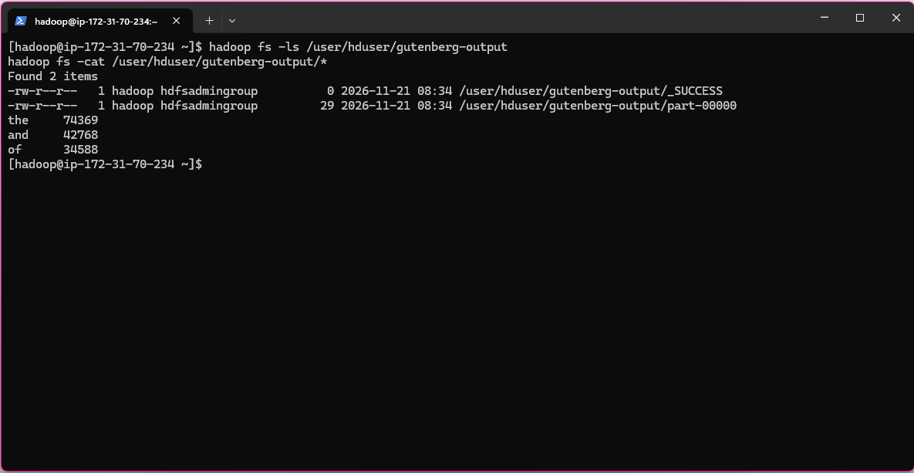

# Hadoop Training – Answers

Cluster: Amazon EMR 7.14.0 (Core Hadoop), instance type m5.xlarge (1 primary, 1 core, 1 task), region us-east-1.
Input: 3 Gutenberg books (5000-0.txt, 2600-0.txt, 1399-0.txt) in `/user/hadoop/gutenberg`.

## Exercise 1

Job counters from the two runs:

| Counter | Run 1 (default) | Run 2 (`-numReduceTasks 6`) |
| --- | --- | --- |
| Launched map tasks | 9 | 9 |
| Launched reduce tasks | 3 | 6 |
| Merged Map outputs | 27 | 54 |
| Output part files | 3 | 6 |

**Q1. How many files are there?**
6 output files (`part-00000` to `part-00005`), plus the `_SUCCESS` status file, which is not a data file.

**Q2. Did the number of mappers change?**
No. It stayed 9. The number of mappers is set by the number of input splits (`number of splits:9`: the 3 input files were divided into 9 splits). Changing the number of reducers does not change the input. Each book is smaller than one HDFS block, but Hadoop Streaming uses the old `mapred` API, which divides the total input size by the cluster's map-task hint to get a target split size of about 0.9 MB. So each book was cut into several splits.

**Q3. Did the number of reducers change?**
Yes, from 3 to 6, because we set it explicitly with `-numReduceTasks 6`.

**Q4. Did the number of output files change? Why?**
Yes, from 3 to 6. Each reducer writes its own output file (one partition), so the number of part files equals the number of reducers. The total output size stayed the same (889,817 bytes); it was just split into more, smaller files.

**Q5. What does the value of 'Merged Map outputs' represent, and how is it calculated?**
It is the number of map output segments that the reducers fetched and merged during the shuffle phase. Each mapper partitions its output into one segment per reducer, and each reducer pulls its segment from every mapper. So it equals mappers × reducers: 9 × 3 = 27 in run 1, and 9 × 6 = 54 in run 2.

## Exercise 2

**Q1. Is your change in the mapper or in the reducer?**
In the mapper. The words must be normalized (trailing `,` and `.` stripped, lower-cased) before the shuffle groups them by key. Otherwise `The`, `the` and `the,` reach the reducer as different keys and cannot be merged. The reducer is unchanged.

**Q2. Code:** [`mapper2.py`](mapper2.py) (used with the original [`reducer.py`](reducer.py))

Run command:
```
hadoop jar /usr/lib/hadoop/hadoop-streaming.jar -file ./mapper2.py -mapper ./mapper2.py -file ./reducer.py -reducer ./reducer.py -input /user/hadoop/gutenberg/* -output /user/hduser/gutenberg-output
```

Top words after the change (for example, `the` went from 68,638 to 74,369):
```
he      17589
in      20339
a       20738
to      31891
of      34588
and     42768
the     74369
```

## Exercise 3

**Q1. Is your change in the mapper or in the reducer?**
In the reducer. Only the reducer knows the final total count of each word, so only it can pick the top 3. The reducer keeps a heap of the 3 largest counts and prints them at the end, sorted in descending order. All sorting and filtering is done inside the Python code, with no external pipes. We run with `-numReduceTasks 1` so that a single reducer sees all words. With several reducers, each one would output its own top 3.

**Q2. Code:** [`reducer3.py`](reducer3.py) (used with the Exercise 2 mapper, [`mapper2.py`](mapper2.py))

Run command:
```
hadoop jar /usr/lib/hadoop/hadoop-streaming.jar -file ./mapper2.py -mapper ./mapper2.py -file ./reducer3.py -reducer ./reducer3.py -input /user/hadoop/gutenberg/* -output /user/hduser/gutenberg-output -numReduceTasks 1
```

**Q3. Output:**



The result matches the top 3 of the full Exercise 2 count (`the 74369`, `and 42768`, `of 34588`).
